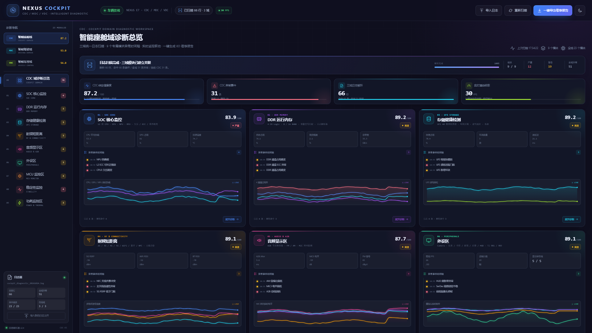
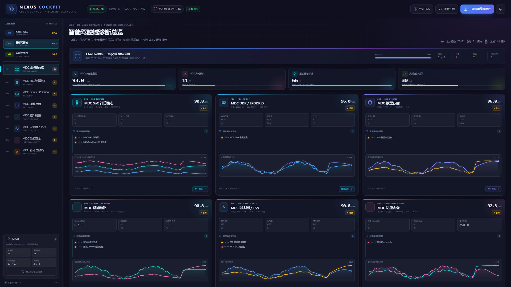
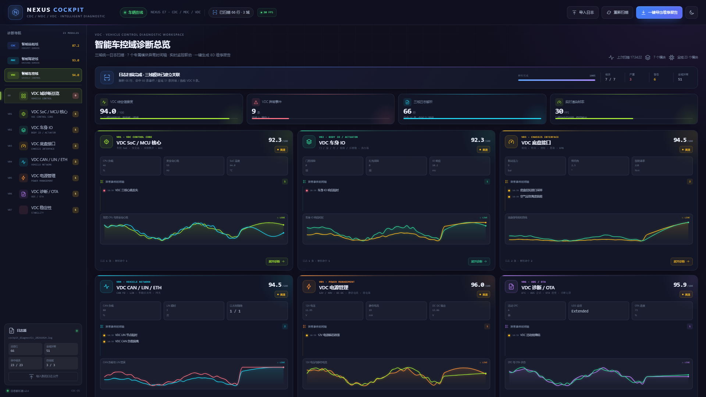
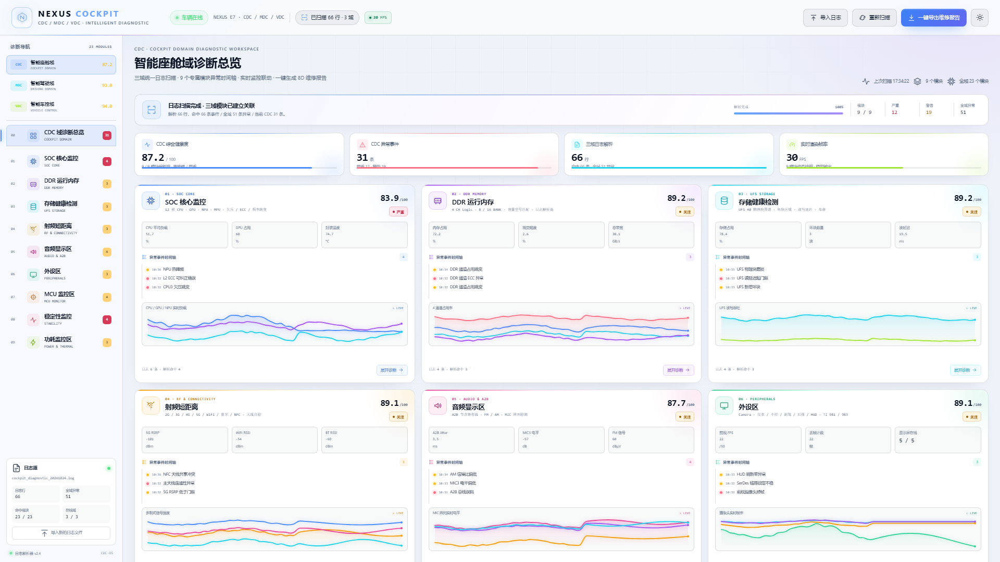

# NEXUS COCKPIT · 三域智能诊断工作台

面向新能源智能座舱、智能驾驶与智能车控的 **1920×1080 大屏诊断控制台**。以“日志扫描 → 异常事件时间轴 → 实时监控图 → 8D 维修报告”为主线，覆盖 **CDC 智能座舱域 / MDC 智能驾驶域 / VDC 智能车控域**，共 23 个专属诊断模块。



MDC 智能驾驶域：



VDC 智能车控域：



白色主题预览：



## 三域模块

### CDC · 智能座舱域（9 模块）

| 模块 | 关键内容 |
| --- | --- |
| SOC 核心监控 | 12 核 CPU、GPU / NPU / MPU、欠压、ECC、频率跳变 |
| DDR 运行内存 | 4G / 6G / 8G / 16G / 32G 型号匹配，4 CH × 8/16 BANK |
| 存储健康检测 | UFS 40 块物理图谱、坏块、读写延迟 |
| 射频短距离 | 2G / 3G / 4G / 5G / WiFi / 蓝牙 / 星闪（绿牙）/ NFC |
| 音频显示区 | A2B 节点与寄存器、FM / AM、4 路 MIC |
| 外设区 | Camera、仪表 / 中控 / 副驾 / 后排 / HUD（HUG）、TI 981/983、USB |
| MCU 监控区 | ADC、风扇、CAN、PCIe、安全岛 / RDA / NRDA |
| 稳定性监控 | panic / 重启 / ANR / crash |
| 功耗监控区 | 整机功率、温度、电源轨 |

### MDC · 智能驾驶域（7 模块）

| 模块 | 关键内容 |
| --- | --- |
| MDC SoC 计算核心 | 8 核 CPU、双 NPU、GPU、锁步安全岛、ECC |
| MDC DDR / LPDDR5X | 4 通道带宽、ECC、BEV 帧缓冲 |
| MDC 模型存储 | NVMe 模型分区、加载时延、坏块 |
| MDC 感知链路 | 8 路 Camera、2 路 LiDAR、5 路 Radar、USS、时间同步 |
| MDC 以太网 / TSN | 10G 以太网、TSN、PTP、PCIe |
| MDC 功能安全 | 锁步核、安全岛、watchdog、E2E、ASIL-D |
| MDC 功耗与散热 | SoC 功耗、结温、风扇、电源轨 |

### VDC · 智能车控域（7 模块）

| 模块 | 关键内容 |
| --- | --- |
| VDC SoC / MCU 核心 | 车控 SoC、Cortex-R 安全岛、锁步、ECC、心跳 |
| VDC 车身 IO | 门 / 窗 / 灯 / 座椅 / 后视镜 / 执行器 |
| VDC 底盘接口 | 制动、转向、扭矩、悬架、EPB |
| VDC CAN / LIN / ETH | CAN FD、LIN、以太网、网关 |
| VDC 电源管理 | 12V / 48V、DC-DC、静态电流、继电器 |
| VDC 诊断 / OTA | DTC、UDS 会话、OTA 进度 |
| VDC 稳定性 | watchdog、复位、故障、启动自检 |

每个域都有独立的 **域健康评分、模块导航、异常事件时间轴与实时监控图**；点击模块卡片或左侧导航进入详情页，可查看完整时间轴筛选、模块专项表格、实时曲线与 AI 处置建议。

## 日志扫描与解析

页面首次加载会自动扫描内置的三域联合日志：

- 共 **66 行日志、66 条事件、51 条异常**（19 严重 / 32 警告）。
- `[SOC] [DDR] [UFS] [RF] [AUDIO] [PERIPH] [MCU] [STABILITY] [POWER]` 映射到 CDC。
- `[MDC]` 按 code 映射到 MDC 的 SoC / DDR / 存储 / 感知 / 网络 / 安全 / 功耗模块。
- `[VDC]` 按 code 映射到 VDC 的 SoC / IO / 底盘 / 网络 / 电源 / 诊断 / 稳定性模块。
- 支持 **导入日志**：粘贴文本或选择 `.log` / `.txt` 文件，浏览器本地解析，不上传服务器。
- 支持 `code=...` 与 `key=value` 字段提取，自动生成事件标题、详细描述和指标标签。

示例：

```text
2026-10-24 10:32:14.326 [SOC] [ERROR] code=SOC_CPU_UV core=3 vdd=0.71V threshold=0.75V duration=12ms
2026-10-24 10:38:28.080 [MDC] [ERROR] code=MDC_SAFETY_LOCKSTEP core=1 mismatch=2
2026-10-24 10:39:25.900 [VDC] [ERROR] code=VDC_WATCHDOG reset=1 reason=12V-dip
```

DDR 详情页会根据容量选择匹配内存型号与 BANK 数，并将日志中的 `ch` / `bank` 字段关联到 4 通道逻辑映射面板。

## 一键导出 8D 维修报告

右上角 **一键导出维修报告**（或详情页 AI 建议区按钮）会生成独立 HTML 报告并下载：

- 8D 结构：D1 小组、D2 问题描述、D3 临时遏制、D4 根因分析、D5 永久措施、D6 验证、D7 预防、D8 关闭。
- 自动遍历 **CDC / MDC / VDC 三域 23 个模块**的异常时间轴。
- 每个模块自动生成一张 **实时监控图 PNG 快照**并嵌入报告附件。
- 使用 [8d-template.js](8d-template.js) 中的 **Jinja2 风格模板**：`{{ variable }}` 与 ``，由 [app.js](app.js) 中的轻量模板引擎渲染。
- 报告支持直接打印/另存为 PDF。

示例报告约 1.5 MB，包含 23 个模块卡片、51 条异常时间轴事件与 23 张图表快照。

## 主题与交互

- 默认 **Fluent 暗色**，高饱和三域配色：CDC 蓝、MDC 青、VDC 青柠绿。
- 右上角太阳 / 月亮按钮切换 **白色主题**，选择写入 `localStorage`，刷新保持。
- 单 `requestAnimationFrame` + 可见画布裁剪，目标 30 FPS；顶部显示目标帧率与实测提示。
- 域切换、模块导航、时间轴筛选、日志导入、8D 导出全部可交互。
- 响应式适配 1920 / 1440 / 1024 / 390 宽度，无横向溢出。

## 文件结构

```text
.
├─ index.html          # 工作台外壳、图标 sprite、主题初始化
├─ styles.css          # Fluent 暗色 / 白色主题、三域导航、时间轴、详情页
├─ app.js              # 三域日志解析、实时数据、图表循环、模块渲染、8D 导出
├─ 8d-template.js      # Jinja2 风格三域 8D HTML 模板
├─ favicon.svg
├─ preview.png         # 1920×1080 CDC 暗色主界面
├─ preview-mdc.png     # 1920×1080 MDC 驾驶域
├─ preview-vdc.png     # 1920×1080 VDC 车控域
├─ preview-light.png   # 白色主题预览
└─ README.md
```

## 接入真实数据

当前实时遥测为演示级模拟，日志解析器为真实可用的前端解析逻辑。

- 实时遥测集中在 `app.js` 的 `state.live`，每 500ms 由 `updateTelemetry()` 刷新；可替换为 WebSocket / MQTT / SSE。
- 日志入口为 `state.sourceLogs`，解析函数为 `parseDiagnosticLogs()`；可对接车端日志服务或诊断仪导出文件。
- 三域模块定义在 `MODULE_DEFS`（CDC_MODULES / MDC_MODULES / VDC_MODULES），AI 处置建议在 `MODULE_ACTIONS`。
- 8D 报告字段在 `build8DContext()`，模板在 `8d-template.js`。
- 若接入真实 VIN、用户或车辆位置数据，请在生产环境增加鉴权、脱敏与访问控制。

> 页面底部、扫描面板和导出报告均标注 `DEMO DATA · 模拟数据`。演示数据不作为真实维修依据。
