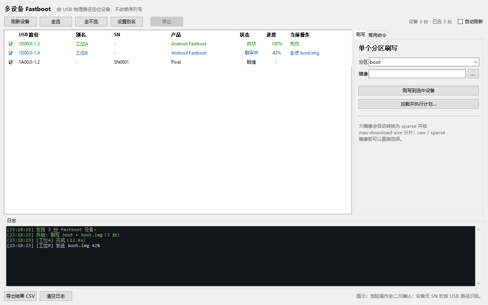

# fbhub · 多设备 Fastboot 工具

一台电脑同时连接多台 Android 设备，按 **USB 物理路径**（而不是序列号）批量刷写、重启、擦除、读取变量、执行 OEM 命令。

> 面向产线/维修场景：设备没有写 SN，或者多台设备 SN 为空/重复时，`fastboot -s <SN>` 无法区分设备。fbhub 直接通过 WinUSB 与每台设备的 fastboot 接口通信，用 USB HUB 端口链定位设备，因此不依赖 SN。



> 无真机时的验证记录、上机步骤和风险见 **[docs/VERIFICATION.md](docs/VERIFICATION.md)**。当前环境没有连接 Android 真机，实际 USB 握手/刷写需明天上机验证；先跑 `fbhub doctor`，不要直接刷机。

---

## 1. 它解决什么问题

传统命令：

```bat
fastboot -s 1234567890 reboot
fastboot -s 1234567890 flash boot boot.img
```

问题：

- 设备没有写 SN，`-s` 无法使用；
- 多台设备同时连接时，`fastboot` 会报 `more than one device`；
- Windows 版 AOSP `fastboot` 不支持 `-s usb:1-3` 这种按 USB 路径选择设备（Linux 版支持，Windows 版没有实现）。

fbhub 的做法：

1. 用 Windows SetupAPI 枚举所有 USB 设备接口；
2. 打开使用 WinUSB 驱动的接口，读取接口描述符，筛选 `class=0xFF / subclass=0x42 / protocol=0x03` 的 fastboot 接口；
3. 从 Windows `DEVPKEY_Device_LocationPaths` 解析物理端口链，例如 `1D00:0-1.3`；
4. 自己实现 fastboot USB 协议（命令、`download`、`flash`、`erase`、`getvar`、`oem`、`reboot` 等）；
5. 每台设备一个线程，并行执行同一份命令/刷机计划；
6. 大镜像自动转成 Android sparse 格式，并按目标设备的 `max-download-size` 分片发送。

---

## 2. 功能

- **按 USB 物理路径选设备**：`--path 1D00:0-1.3`，也支持 `--hub 1 --index 3` 按最后两级端口过滤。
- **1 对多并行**：所有选中设备同时执行；线刷/命令都支持。
- **刷写**：
  - raw 镜像（`boot.img`、`vendor_boot.img` 等）；
  - 已经是 sparse 的镜像（`super.img` 等）；
  - 超过 `max-download-size` 的镜像自动 sparse 分片；
  - 自动把 AVB footer 移动到分区末尾（与 Android fastboot 行为一致，适配 boot 分区大于 boot.img 的设备）；
  - 单分区刷写 + 多步骤 JSON 计划。
- **常用命令**：
  - `reboot [system|bootloader|fastboot|recovery|edl]`
  - `getvar <name>` / `getvar all`
  - `erase <partition>`（危险操作会确认）
  - `oem <args>`（例如 `oem edl`）
  - `flashing unlock / lock / unlock_critical / get_unlock_ability`
  - `set_active <slot>`
  - `boot <image>`（临时启动，不写分区）
  - `continue`
  - 原始 fastboot 命令（`raw`）
- **图形界面**：设备表格、勾选、刷写、命令、进度、日志、结果 CSV 导出。
- **CLI**：适合脚本/批处理；支持 `--dry-run`、`--json`、`--yes`。
- **别名**：把 `1D00:0-1.3` 映射成“工位A”，配置保存在 `%APPDATA%\fbhub\config.json`。
- **诊断**：`fbhub doctor` 显示 WinUSB 接口、驱动状态，以及 `fastboot.exe devices -l` 的对比结果。
- **零第三方依赖**：只用 Python 标准库 + Windows 自带 WinUSB/Restart Manager DLL，不需要 `pip install`。

---

## 3. 系统要求

- Windows 10 / 11（x64）；
- Python 3.10 或更高版本（python.org 安装包自带 Tkinter 即可）；
- 设备处于 **fastboot / bootloader** 模式；
- 设备接口使用 **WinUSB** 驱动（安装 Google USB Driver 或设备厂商的 fastboot 驱动）。

### 判断驱动是否合适

设备管理器里应看到类似：

```text
Android Device
  └─ Android Bootloader Interface
```

或设备厂商的 `Fastboot Interface`。如果 `fastboot devices` 能看到设备，通常 fbhub 也能看到；如果 fbhub 看不到但 `fastboot devices` 能看到，运行 `fbhub doctor` 查看原因。

> 注意：部分厂商使用 libusbK / libusb-win32 或私有驱动。fbhub 使用 WinUSB API，这类驱动可能需要换成 WinUSB 版本，或使用厂商提供的刷机工具。换驱动有风险，请先确认。

---

## 4. 快速开始

### 4.1 图形界面

双击：

```text
run_gui.bat
```

或者：

```bat
python -m fbhub gui
```

### 4.2 命令行

```bat
run_cli.bat list
run_cli.bat doctor
```

等价于：

```bat
python -m fbhub list
python -m fbhub doctor
```

如果 Python 不在 PATH，请先安装 Python 并勾选 “Add Python to PATH”。

---

## 5. 设备路径格式

fbhub 显示的路径类似：

```text
1D00:0-1.3
```

含义：

| 部分 | 含义 |
| --- | --- |
| `1D00` | USB 主控制器在 PCI 总线上的位置（来自 Windows location path，例如 `PCI(1D00)`） |
| `0` | Windows 的 root hub 序号（同一控制器可能有多个） |
| `1.3` | 从 root hub 到设备的端口链：先经过 hub 的 1 号端口，再经过下一级 hub 的 3 号端口 |

最后一段 `3` 就是通常说的 **port index**；前一段 `1` 是上一级 HUB 的端口。不同主控制器可能有相同端口号，所以路径里保留了 PCI 位置，避免 `0-1.3` 在多控制器机器上冲突。

### 按路径选择

```bat
:: 单台
fbhub reboot bootloader --path 1D00:0-1.3

:: 多台
fbhub flash boot boot.img --path 1D00:0-1.3 --path 1D00:0-1.4

:: 也支持逗号分隔
fbhub getvar current-slot --path 1D00:0-1.3,1D00:0-1.4

:: 按最后两级端口过滤（同型号多台时很方便，但不同控制器可能重号）
fbhub reboot bootloader --hub 1 --index 3
```

### 别名

```bat
fbhub alias 1D00:0-1.3 工位A
fbhub alias --list
fbhub flash boot boot.img --alias 工位A
```

别名会显示在 GUI 的“别名”列和 CLI 的日志里。

### 列出设备

```bat
fbhub list
fbhub list --details
fbhub list --json
```

`--details` 会显示 Windows 的原始 location path 和设备实例 ID，便于排查 HUB/端口对应关系。

---

## 6. CLI 用法

### 6.1 刷写单个分区

```bat
:: 所有设备
fbhub flash boot boot.img --all

:: 指定设备
fbhub flash boot boot.img --path 1D00:0-1.3 --path 1D00:0-1.4

:: 跳过确认（脚本/产线）
fbhub flash boot boot.img --all --yes

:: 只预览，不碰设备
fbhub flash boot boot.img --all --dry-run
```

镜像可以是 raw，也可以是 sparse。大于设备 `max-download-size` 时自动分片；分片进度会显示在 GUI/CLI。

### 6.2 执行 JSON 计划

```bat
fbhub plan examples/plan.example.json --all --yes
fbhub plan examples/plan.example.json --path 1D00:0-1.3 --dry-run
```

计划文件示例：

```json
{
  "name": "factory-image",
  "steps": [
    {"action": "flash", "partition": "boot", "image": "images/boot.img"},
    {"action": "flash", "partition": "vendor_boot", "image": "images/vendor_boot.img"},
    {"action": "flash", "partition": "vbmeta", "image": "images/vbmeta.img"},
    {"action": "erase", "partition": "misc"},
    {"action": "reboot", "target": "bootloader"}
  ]
}
```

`image` 相对路径以 **计划文件所在目录** 为基准。

支持的 step：

| action | 参数 | 说明 |
| --- | --- | --- |
| `flash` | `partition`, `image` | 刷写分区 |
| `erase` | `partition` | 擦除分区 |
| `reboot` | `target`（可选） | `system` / `bootloader` / `fastboot` / `recovery` / `edl` |
| `getvar` | `name` | 读取变量，结果写入日志/CSV |
| `oem` | `args` | 例如 `["edl"]` |
| `flashing` | `target` | `unlock` / `lock` / `unlock_critical` / `get_unlock_ability` |
| `set_active` | `target` | 切换 slot |
| `boot` | `image` | 临时启动 |
| `continue` | 无 | 继续启动 |
| `sleep` | `seconds` | 等待 |
| `raw` | `command` | 原始 fastboot 命令 |

> `format`、`flashall`、`update`、`sideload`、动态分区管理命令没有实现，请使用 Android platform-tools 的 `fastboot`。这些命令依赖文件系统生成、ZIP 解析或逻辑分区元数据，不在本工具范围内。

### 6.3 常用命令

```bat
:: 重启
fbhub reboot --all
fbhub reboot bootloader --all
fbhub reboot fastboot --path 1D00:0-1.3
fbhub reboot recovery --all
fbhub reboot edl --all

:: 读变量
fbhub getvar current-slot --all
fbhub getvar max-download-size --path 1D00:0-1.3

:: 擦除
fbhub erase misc --all --yes

:: 解锁/上锁（会确认）
fbhub run --all -- flashing unlock
fbhub run --all -- flashing lock
fbhub run --all -- flashing get_unlock_ability

:: OEM
fbhub oem --all -- edl
fbhub run --all -- oem device-info

:: 任意 fastboot 命令（透传）
fbhub run --all -- set_active a
fbhub run --all -- reboot-bootloader
```

`run` 后面的 `--` 用于把参数和 fbhub 自己的选项分开。

### 6.4 结果输出

```bat
fbhub plan factory.json --all --json
fbhub plan factory.json --all --csv result.csv
```

JSON 结构：

```json
{
  "ok": true,
  "plan": "factory",
  "devices": [{"location": "1D00:0-1.3", "serial": null, "...": "..."}],
  "results": [
    {"location": "1D00:0-1.3", "ok": true, "message": "完成", "duration": 12.3, "output": []}
  ],
  "summary": {"ok": 1, "failed": 0, "total": 1}
}
```

退出码：`0` 全部成功；`1` 有设备失败或参数/连接错误；`2` 用法错误。

---

## 7. GUI 用法

1. 连接设备，进入 fastboot；
2. 打开 GUI；
3. 点“刷新设备”；
4. 勾选要操作的设备（新设备默认不勾选，避免误刷）；
5. “刷写”页：填分区、选镜像，点“刷写到选中设备”；
6. 或“加载并执行计划”；
7. “常用命令”页：重启、解锁、擦除、读变量、原始命令；
8. 右侧“日志”显示每台设备的输出；失败会红色标记；
9. “导出结果 CSV”保存本次结果；
10. “设置别名”把路径改成工位名。

危险操作（刷写、擦除、解锁）会弹出确认框，列出命令和目标设备。

“自动刷新”每 3 秒扫描一次 USB；执行任务时不会刷新，避免干扰。

---

## 8. 工作原理（简版）

### 8.1 设备枚举

```text
SetupDiGetClassDevs(GUID_DEVINTERFACE_USB_DEVICE / Android USB GUID)
  -> SetupDiEnumDeviceInterfaces
  -> CreateFile(device interface path)
  -> WinUsb_Initialize
  -> WinUsb_QueryInterfaceSettings(0)
       class == 0xFF, subclass == 0x42, protocol == 0x03 ?
  -> WinUsb_QueryPipe -> bulk IN/OUT
  -> WinUsb_GetDescriptor -> VID/PID/serial/product
```

物理路径来自：

```text
DEVPKEY_Device_LocationPaths =
  PCIROOT(0)#PCI(1D00)#USBROOT(0)#USB(1)#USB(3)
  -> 1D00:0-1.3
```

### 8.2 Fastboot 协议

- 命令：ASCII 字符串，例如 `download:00001000`、`flash:boot`、`getvar:current-slot`；
- 响应：`OKAY` / `FAIL` / `INFO` / `DATA<8位hex>` / `TEXT`；
- 数据：`download:<size>` 后连续写 `<size>` 字节，再读 `OKAY`；
- 刷写：先 `download`，再 `flash:<partition>`。

### 8.3 大镜像分片

参考 AOSP `fastboot` + `libsparse` 的行为：

- 如果镜像小于 `max-download-size`：直接发送（raw 或 sparse）；
- 如果大于：
  1. raw 镜像转换成 4096 字节块的 sparse；
  2. 按 `min(max-download-size, 32 MiB)` 切成多个 **完整长度** 的 sparse 分片：每个分片头部 `total_blks` 仍然是整张镜像的块数，未写入的区域用 `DONTCARE` 跳过；
  3. 每个分片依次 `download` + `flash:<partition>`；
  4. 设备根据 `DONTCARE` 跳到正确偏移，最终写入完整镜像。

这样可以处理 8 GiB 的 `super.img`，而不用把整个镜像读进内存。

---

## 9. 故障排查

### 9.1 `fbhub list` 没有设备

```bat
fbhub doctor
```

看：

- `WinUSB 接口` 列表里有没有 `FASTBOOT`；
- 如果显示 `WinUsb_Initialize failed ... 没有使用 WinUSB 驱动`，说明设备驱动不是 WinUSB；
- 如果 `fastboot.exe devices -l` 能看到设备，但 fbhub 看不到，通常是驱动类型问题或设备被其他工具占用；
- 关闭其他刷机工具、IDE、adb 服务后再试（`adb kill-server` 不影响 fastboot，但有些套件会占用）。

### 9.2 设备在 GUI 里显示但 `SN=-`

正常。没有写 SN 的设备就该这样；用 USB 路径/别名区分。

### 9.3 路径和物理端口对不上

- `fbhub list --details` 查看 `DEVPKEY_Device_LocationPaths`；
- 插拔设备观察哪一行出现/消失；
- 给路径设置别名（`fbhub alias` 或 GUI 按钮）。

### 9.4 刷写失败 / 超时

- 确认镜像和分区名匹配（`boot` 不是 `boot_a`，视设备而定）；
- 大镜像分片时，设备端写入慢是正常的；把 `response_timeout_s` 调大；
- 传输中途拔线会导致分区不完整，需要重新刷；
- 设备端返回的 `FAIL` 文本会显示在日志中。

### 9.5 多台设备速度慢

USB HUB 带宽共享，同时刷多台不一定比逐台快。可以用 `--jobs 2/4` 限制并发，或把设备分散到不同控制器。

### 9.6 `fastboot.exe` 能用，fbhub 不能用

本工具不复用 `fastboot.exe`，而是直接访问 WinUSB。请确认：

- 设备接口是 WinUSB（设备管理器 → 驱动程序 → 驱动程序详细信息）；
- 没有其他程序独占；
- 以管理员身份运行一次（驱动安装/某些 HUB 需要）。

---

## 10. 配置文件

默认路径：

```text
%APPDATA%\fbhub\config.json
```

可用 `--config` 或环境变量 `FBHUB_CONFIG` 指定。

```json
{
  "max_part_size_mb": 32,
  "response_timeout_s": 180,
  "command_timeout_s": 20,
  "jobs": 0,
  "auto_refresh_s": 3,
  "aliases": {
    "1D00:0-1.3": "工位A",
    "1D00:0-1.4": "工位B"
  },
  "fastboot_exe": "fastboot",
  "confirm_destructive": true
}
```

| 字段 | 说明 |
| --- | --- |
| `max_part_size_mb` | 大镜像分片上限（还会受设备 `max-download-size` 限制） |
| `response_timeout_s` | 等待刷写/擦除最终响应的超时 |
| `command_timeout_s` | 普通命令响应超时 |
| `jobs` | 并发数；0 = 每台设备一个线程 |
| `auto_refresh_s` | GUI 自动刷新间隔 |
| `aliases` | 路径 → 别名 |
| `fastboot_exe` | 仅 `doctor` 诊断用 |
| `confirm_destructive` | 是否要求危险操作确认 |

---

## 11. 代码结构

```text
fastboot-hub/
├─ fbhub/
│  ├─ winusb.py      # ctypes: SetupAPI / WinUSB / CfgMgr32
│  ├─ discovery.py   # 设备枚举、打开、诊断
│  ├─ protocol.py    # fastboot 协议 + 大镜像分片刷写
│  ├─ sparse.py      # Android sparse 解析/生成/分片
│  ├─ topology.py    # USB 路径解析与筛选
│  ├─ plan.py        # JSON 计划 / CLI 命令解析
│  ├─ service.py     # 多设备并行调度
│  ├─ config.py      # 配置与别名
│  ├─ cli.py         # 命令行
│  └─ gui.py         # Tkinter 界面
├─ tests/            # 单元测试（不需要真实设备）
├─ examples/         # 计划示例
├─ run_gui.bat
├─ run_cli.bat
└─ doctor.bat
```

---

## 12. 开发与测试

```bat
python -m unittest discover -s tests -v
python -m compileall -q fbhub
```

测试覆盖：

- sparse 编码/解析/分片/零块/末块补齐；
- USB 路径解析与选择；
- fastboot 协议（fake transport）：getvar、download、flash、FAIL、reboot、超时；
- 计划解析；
- 多设备并行、单台失败不影响其他设备、dry-run、重启后停止后续步骤。

> 没有真实 fastboot 设备时，WinUSB 的物理 I/O 只能做枚举/驱动诊断；协议层用模拟 transport 测试。上产线前请先用一台设备做 `getvar`、`flash boot` 验证。

---

## 13. 已知限制

- 仅 Windows；Linux/macOS 请用原生 `fastboot -s usb:...`。
- 不支持 `format` / `flashall` / `update` / `sideload` / 动态分区创建删除。
- 不支持网络 fastboot（`tcp:` / `udp:`）。
- 重启后设备会重新枚举；计划中 `reboot` 之后的步骤会跳过。
- 停止按钮只在当前 USB 操作结束后生效，不能中断正在传输的 `download`。
- 没有实现 slot 自动后缀（`boot` → `boot_a`），请按设备实际分区名填写。
- 设备必须使用 WinUSB 驱动；libusbK/私有驱动的设备可能无法打开。

---

## 14. 安全提示

- 刷错分区、刷错镜像、刷写中拔线都可能导致设备无法启动；
- 第一次使用先 `fbhub list` / `getvar`，确认路径和分区；
- 产线脚本建议先 `--dry-run` 预览，再小批量验证，最后 `--yes`；
- 本工具不修改设备的解锁状态，解锁/上锁请确认设备允许。

---

## 15. License / 反馈

内部工具，未附带开源许可证。使用前请确认与设备厂商的刷机授权/保修条款一致。
